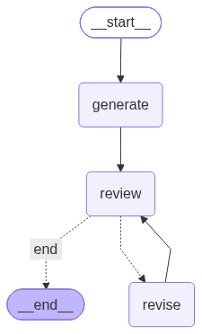

# LangGraph 后端编排架构设计与 Demo 实现

## 1. 核心概念理解
*   **State（状态）**：整个图共享的“档案袋”，里面存放所有节点需要读取或修改的数据（本 Demo 中为需求、代码、审查结论、重试次数）。
*   **Node（节点）**：处理函数（Agent）。接收 State，只返回自己要更新的字段（增量），LangGraph 负责合并。
*   **Edge（边）**：分为普通边（固定流向）和条件边（通过 Router 函数动态判定走向）。

## 2. 我的 Demo 架构设计

### 2.1 业务场景
一个自动写代码并审查的闭环工作流：需求分析 -> 生成代码 -> 审查代码 -> （不通过则打回重写，直至通过或达到重试上限）。

### 2.2 流程图

### 2.3 State 详细设计
*   `task`: 用户的原始需求。
*   `code`: 当前生成的代码。
*   `review_verdict`: 审查结论（pass / fail）。
*   `retry_count` / `max_retries`: 控制循环的硬性边界，防止死循环。

### 2.4 编排核心逻辑（口头汇报要点）
1.  **起始**：从 `generate` 节点开始，根据需求生成代码草稿。
2.  **审查**：进入 `review` 节点。该节点会对代码进行判定。
3.  **路由判定**：在 `review` 之后，通过 `route_after_review` 这个 Router 函数进行决策：
    *   如果判定为 `pass`，直接走向 `__end__` 结束。
    *   如果判定为 `fail` 且 `retry_count` 未达上限，走向 `revise` 节点。
    *   如果达到重试上限，强制结束，防止无意义循环。
4.  **打回重写**：`revise` 节点拿到审查反馈修改代码，并将 `retry_count` 加 1，然后**重新连回 `review` 节点**进行下一轮审查。
## 3. 对两个 Skill 的理解
*   **writing-skill**：用于规范开发文档的写法（强调结构、证据、可核验）。
*   **dev-skill**：用于规范开发流程（具体的用途需结合分支里的 SKILL.md 定义）。