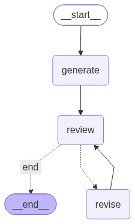

# LangGraph 后端编排 Demo 开发文档

> 本文件严格遵循 `writing-skill` 的治理规范：所有技术断言均基于源码与实际运行证据，明确区分设计意图与实现边界。

## 1. Artifact Brief (产物简报)
*   **项目目标**：验证 LangGraph 框架下，基于 State（状态）驱动的多节点（Node）与条件路由（Edge）的编排能力。
*   **目标读者**：项目负责人 / 架构评审人。
*   **验证方式**：本地可运行的后端编排脚本及实际控制台输出证据。

## 2. Architecture & Evidence (架构设计与源码证据)
*依据：`app.py` 源码实证*

### 2.1 状态定义 (State)
共享状态贯穿整个图的流转，包含任务描述、代码草稿、审查结论及循环控制的硬性边界（重试次数）。
```python
class CodingState(TypedDict):
    task: str
    code: str
    review_verdict: Literal["pass", "fail"]
    review_feedback: str
    retry_count: int
    max_retries: int
```

### 2.2 节点流转与条件路由 (Node & Edge)
使用了普通边控制固定流向，使用条件边实现“审查失败则打回重写”的闭环。

```python
# 构建条件边
builder.add_conditional_edges(
    "review",
    route_after_review,
    {
        "end": END,
        "revise": "revise"
    }
)
```

架构拓扑图（由 LangGraph 自动生成）：




## 3. Runtime Verification (运行验证证据)
运行环境：Python 3.x, langgraph

执行命令：`python app.py`

终端输出证据（证明逻辑闭环真实跑通，包含 Node 执行与 Router 判定过程）：
```txt
========== 开始执行工作流 ==========
>>> 正在构建流程图...
>>> 流程图构建成功！

--- [Node] 开始生成代码，任务: 写一个计算两数之和的函数 ---

--- [Node] 开始审查代码 ---
审查结果：不通过，代码还是个半成品。
--- [Router] 判定下一步走向 ---
-> 走向: 打回修改 (revise)

--- [Node] 收到反馈，开始修改代码。当前重试次数: 0 ---

--- [Node] 开始审查代码 ---
审查结果：通过！
--- [Router] 判定下一步走向 ---
-> 走向: 结束 (END)

========== 执行结束 ==========
最终产出的代码:
# 修改依据: 代码仍包含 TODO 占位，请实现具体逻辑。
print('功能已实现')
总共重试了 1 次
最终审查状态: pass
```

结论：终端日志明确输出了 generate -> review -> fail -> revise -> review -> pass -> end 的完整流转链路，证明条件边（Conditional Edge）与循环机制符合架构设计预期。


## 4. Boundary Record (边界与局限性声明)
遵循 writing-skill 的“代码即真理，不夸大”原则，明确本 Demo 的边界：

模型边界：当前 Demo 的 `generate_node` 和 `review_node` 采用本地静态规则模拟，未实际接入 LLM API，旨在验证图编排逻辑。

功能边界：本 Demo 仅为验证后端图编排（Graph Orchestration）逻辑，未包含前端界面、数据库持久化存储及真实业务鉴权机制。

性能边界：当前验证仅证明逻辑闭环可运行，不包含关于高并发或算法性能的指标声明。
